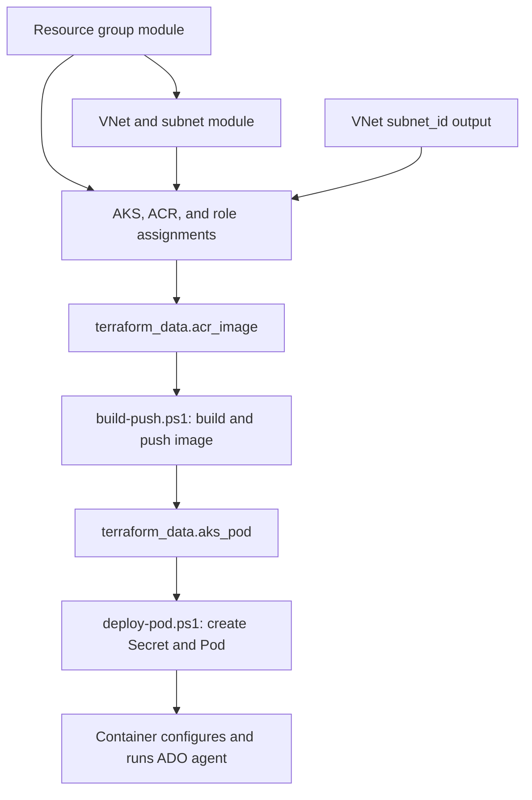

# Terraform AKS Azure DevOps Agent

This repository provisions an Azure resource group, a dedicated virtual network and subnet, an AKS cluster, and an Azure Container Registry (ACR). It builds an Azure DevOps self-hosted agent image, pushes it to ACR, and deploys a Pod running that agent.

The Terraform configuration is in `parent/`; reusable Azure resources are in `child/`; the Docker build context is included in `parent/image/`. The build script downloads a version-pinned Azure Pipelines agent package into that context and validates its SHA-256 checksum before Docker builds the image. The generated large archive is ignored by Git.

## What This Deploys

- One Azure resource group.
- One VNet (`10.0.0.0/16`) and dedicated AKS node subnet (`10.0.1.0/24`).
- One AKS cluster with one default Linux node, attached to that subnet.
- Azure CNI Overlay. The current Pod CIDR is `10.244.0.0/16`; the Service CIDR is `10.1.0.0/16`, with cluster DNS at `10.1.0.10`.
- One Basic ACR with its admin account disabled.
- An `AcrPull` role assignment for the AKS kubelet identity, and an `AcrPush` role assignment for the identity running Terraform.
- A locally built image pushed to ACR and one Kubernetes Pod in the configured namespace.
- A Kubernetes Secret containing the Azure DevOps PAT, referenced by the Pod as `AZDO_PAT`.

The AKS nodes are on the dedicated VNet subnet, but the AKS API endpoint is **public** (`private_cluster_enabled = false`). This preserves the current workflow, which runs `kubectl` from the machine running Terraform. A private API endpoint would require Terraform and `kubectl` to run from a VNet-connected machine or VPN.

The agent makes outbound connections to Azure DevOps. The Pod does not declare an HTTP port, Service, or Ingress; this agent does not need inbound port 80.

## Repository Layout

```text
Terraform_aks/
|-- README.md
|-- child/
|   |-- aks/
|   |   |-- aks.tf          # AKS, ACR, and ACR role assignments
|   |   |-- aks_data.tf     # Current Terraform caller identity
|   |   `-- aks_var.tf      # Inputs accepted by the AKS module
|   |-- rf/
|   |   |-- rf.tf          # Azure resource group
|   |   `-- rg_var.tf      # Resource group module inputs
|   `-- vlan/
|       |-- vnet.tf        # VNet, subnet, and subnet ID output
|       `-- vnet_var.tf    # VNet module inputs
`-- parent/
    |-- Main.tf            # Calls resource group, VNet, and AKS modules
    |-- Provider.tf        # AzureRM provider, identity data, and output
    |-- P_var.tf           # Root Terraform variable declarations and types
    |-- terraform.tfvars   # Non-secret values for this deployment
    |-- image.tf           # Local-exec image build/push resource
    |-- pod.tf             # Local-exec Pod/Secret deployment resource
    |-- build-push.ps1     # Docker build and ACR push
    |-- deploy-pod.ps1     # kubectl Secret and Pod operations
    |-- image/
    |   |-- Dockerfile     # Generic agent image and pinned package extraction
    |   `-- configure_agent.py # Runtime agent registration and process
    |-- .terraform.lock.hcl # Locked provider selection/checksums
    `-- terraform.tfstate  # Local state when the Azure backend is disabled
```

Terraform treats all `.tf` files in `parent/` as one root module; filenames do not determine execution order. `Main.tf` calls child modules by `source` path. A child module can receive input variables and return outputs to its caller.

## Execution and Dependencies

Terraform builds a dependency graph from resource references and `depends_on`. Independent resources can be created concurrently; Terraform does not simply run the files from top to bottom.



1. `module.rg` creates the resource group.
2. `module.vnet` creates the VNet and the separate subnet resource. Its `subnet_id` output is passed to the AKS module.
3. `module.aks` creates AKS and ACR. The AKS default node pool uses `vnet_subnet_id = var.subnet_id`. The two role assignments let the AKS kubelet pull from ACR and let the Terraform caller push to ACR.
4. `terraform_data.acr_image` waits for the AKS module, then runs `build-push.ps1` on the Terraform host.
5. `azuredevops_agent_pool.shared` creates the organization-level `Shared-SelfHosted-Pool` with `auto_provision = true`, which automatically provisions the pool queue in projects.
6. `terraform_data.aks_pod` waits for both the image and agent pool, then runs `deploy-pod.ps1` on the Terraform host.
7. The Pod pulls the image from ACR, reads `AZDO_PAT` from its Secret, and registers the agent in `Shared-SelfHosted-Pool`.

The `depends_on` links establish ordering. The `triggers_replace` lists on the `terraform_data` resources decide when their provisioners run again. A changed trigger replaces the Terraform data resource and runs its provisioner; `depends_on` alone does not mean that a Pod is replaced whenever image contents change.

## Shared Azure DevOps Pool

The `azuredevops_agent_pool.shared` resource manages an organization-level self-hosted pool. Its name comes from `ado_pool` in `terraform.tfvars`; `auto_provision = true` enables automatic queue provisioning for projects, matching the Azure DevOps **Auto-provision this agent pool in all projects** setting. The Pod is explicitly ordered after this pool so its agent registers only after the pool exists.

Terraform uses the Microsoft Azure DevOps provider and the same `ado_pat` variable used to create the Kubernetes Secret. Supply a valid organization PAT through a protected `TF_VAR_ado_pat` environment/secret source. The PAT identity needs organization-level permission to create and manage agent pools; the provider documentation recommends organization-owner privileges. Do not store the PAT in the tracked `terraform.tfvars`.

If `Shared-SelfHosted-Pool` was already created manually, import its Azure DevOps pool ID into `azuredevops_agent_pool.shared` before applying, rather than asking Terraform to create a duplicate.

## How the Image Becomes an Agent

### Dockerfile

The Dockerfile in `parent/image/`:

- Starts from Ubuntu 22.04 and installs agent dependencies.
- Copies the pinned Azure Pipelines agent package from the build context, verifies its SHA-256, and extracts it into `/myagent`.
- Switches to the non-root `agentuser`.
- Receives `AZDO_URL`, `AZDO_POOL`, `AZDO_AGENT`, and `AZDO_PAT` at runtime; it contains no organization or credential defaults.
- Starts `configure_agent.py` as the container entrypoint.

The Docker image is generic. Terraform reads its non-secret deployment settings from `parent/terraform.tfvars` and passes them to the Pod. Direct Docker use must provide all four runtime variables. Multiple concurrent agents need unique names and an intentional scaling/registration strategy.

### Image Build and Push

`parent/image.tf` constructs the full image reference from the ACR login server and `pod_image`. An empty `docker_context_path` resolves to the absolute `parent/image/` path; a non-empty path overrides it. Terraform hashes the Dockerfile and `configure_agent.py` into one source fingerprint, shared by the image-build and Pod-replacement triggers.

`parent/build-push.ps1`:

1. Verifies Azure CLI and Docker are installed and that Docker's Linux engine responds.
2. Checks that the selected context contains a Dockerfile.
3. Downloads the pinned agent archive if it is missing or has the wrong checksum, then verifies its SHA-256.
4. Logs in to ACR using the Azure CLI identity.
5. Builds the image with `docker build --pull` and pushes it to ACR, retrying failed pushes.

Because this uses local execution, the machine running `terraform apply` needs the Azure CLI, Docker Desktop with Linux containers, network access to download the pinned agent archive, access to the Docker context, and permission to push to the registry. The download is done on the host before Docker builds, which avoids requiring the Docker build container to access the package CDN. A CI build or `az acr build` is an alternative if you want to remove the local Docker Desktop dependency.

### Agent Startup

`configure_agent.py` requires `AZDO_URL`, `AZDO_POOL`, `AZDO_AGENT`, and `AZDO_PAT` when the container starts. Terraform supplies the first three from `terraform.tfvars` and the PAT through a Secret. The PAT is passed to agent configuration through `VSTS_AGENT_INPUT_TOKEN`, not a command-line token argument. The script configures the agent with `--replace` and starts `run.sh`.

For direct Docker use, first download the pinned agent archive into `parent/image/` and verify it with `Get-FileHash` against the SHA-256 in `parent/build-push.ps1`. Then build the image and make the PAT available in the shell through a secret manager or other protected source:

```powershell
docker build -t ado-agent:local .\parent\image
docker run --rm `
  --env AZDO_URL="https://dev.azure.com/<organization>/" `
  --env AZDO_POOL="<agent-pool>" `
  --env AZDO_AGENT="<agent-name>" `
  --env AZDO_PAT `
  ado-agent:local
```

In PowerShell, `--env AZDO_PAT` forwards the existing `$env:AZDO_PAT` without placing the token literal in the command. All runtime values must be supplied; there are intentionally no organization, pool, agent-name, or PAT defaults in the image. Never pass the PAT as a build argument or bake it into the image. A pool-based agent is registered to the organization and pool; authorize the desired Azure DevOps project/pipeline to use that pool rather than passing a project name to the standard agent registration command.

If startup fails, inspect the last terminated container's logs first. A duplicate-name message points to Azure DevOps agent registration; a connection timeout points to network access from the Pod to Azure DevOps; missing-variable errors point to image or Secret configuration.

## Values to Configure

The root input declarations and types are in `parent/P_var.tf`; non-secret deployment values are centralized in the automatically loaded `parent/terraform.tfvars`. The PAT is intentionally excluded from that file and supplied as `TF_VAR_ado_pat` by a protected secret source.

| Input | Required? | Purpose and current behavior |
|---|---|---|
| `name_rg` | Yes | Azure resource group name. |
| `rg_location` | Yes | Azure region for the resource group, VNet, AKS, and ACR. |
| `aks_vnet` | Yes | Dedicated VNet name. |
| `subnet_name` | Yes | Node subnet name. Its current prefix is configured in `child/vlan/vnet.tf`. |
| `cluster_name` | Yes | AKS cluster name. |
| `dns_prefix` | Yes | AKS DNS prefix. |
| `vm2take` | Yes | VM SKU for the default node pool. |
| `o_version` | Passed but currently unused | It is passed into the AKS module but not assigned to the cluster's `kubernetes_version`; changing it currently does not select a Kubernetes version. |
| `acr_name` | Yes | Globally unique ACR name; the child variable validates alphanumeric characters. |
| `pod_name` | Yes | Kubernetes Pod name. |
| `pod_namespace` | Yes | Kubernetes namespace. The namespace must already exist. |
| `pod_container_name` | Yes | Container name in the Pod spec. |
| `pod_image` | Yes | Image name and tag, currently configured as `ado-agent:latest`. |
| `ado_url` | Yes | Azure DevOps organization URL, configured in `terraform.tfvars`. |
| `ado_pool` | Yes | Azure DevOps agent pool, configured in `terraform.tfvars`. |
| `ado_agent` | Yes | Agent registration name, configured in `terraform.tfvars`; use a unique name for each concurrent agent. |
| `ado_pat` | Required separately | Sensitive PAT passed through `TF_VAR_ado_pat` and stored in a Kubernetes Secret; never place it in tracked tfvars. |
| `pod_labels` | Yes | Map of Kubernetes labels applied to the Pod. |
| `pod_cpu_request` | Yes | Scheduling CPU request, configured in `terraform.tfvars`. |
| `pod_memory_request` | Yes | Scheduling memory request, configured in `terraform.tfvars`. |
| `pod_cpu_limit` | Yes | CPU limit, configured in `terraform.tfvars`. |
| `pod_memory_limit` | Yes | Memory limit, configured in `terraform.tfvars`. |
| `docker_context_path` | Yes | Empty string selects this repository's `parent/image/`; can be overridden in `terraform.tfvars`. |

Example non-secret settings (these are the values currently in the supplied `terraform.tfvars`):

```hcl
name_rg     = "aks_rg"
rg_location = "westus"

cluster_name = "g18-aks-cluster"
dns_prefix   = "g18akscluster"
vm2take      = "Standard_D2alds_v7"
o_version    = "1.33.0" # Not currently consumed by the AKS resource.
acr_name     = "g18aksacr123"

aks_vnet    = "aks_vnet4subnet"
subnet_name = "aks_subnet1"

pod_name           = "ado-agent"
pod_namespace      = "default"
pod_container_name = "ado-agent"
pod_image          = "ado-agent:latest"
ado_url            = "https://dev.azure.com/<organization>/"
ado_pool           = "<agent-pool>"
ado_agent          = "<unique-agent-name>"
docker_context_path = ""
pod_cpu_request    = "100m"
pod_memory_request = "128Mi"
pod_cpu_limit      = "250m"
pod_memory_limit   = "256Mi"
pod_labels = {
  app = "ado-agent"
}
```

Do not put PATs in `terraform.tfvars`, source code, command history, Docker build arguments, or documentation. Terraform's `sensitive = true` masks display in some CLI output; it is not encryption. Terraform state and plan files can contain sensitive data. Protect them and never commit them. Rotate any PAT that was previously committed or embedded in source.

## Requirements Before Apply

### Local tools and access

- Terraform 1.4 or later (`terraform_data` is a built-in Terraform resource).
- Azure CLI logged in to the intended subscription, with permissions to create the resource group, networking, AKS, ACR, and role assignments.
- Docker Desktop running its Linux container engine.
- `kubectl` installed and available in `PATH`.
- ADO organization/pool access and a valid PAT with permissions to register an agent in the selected pool.
- The selected Docker context exists and contains `Dockerfile` and `configure_agent.py`. The Docker build host must be able to download the pinned agent archive from `download.agent.dev.azure.com`.
- The ACR name is globally unique and valid.

### Network ranges

Current ranges:

| Network | CIDR |
|---|---|
| VNet | `10.0.0.0/16` |
| AKS node subnet | `10.0.1.0/24` |
| Overlay Pods | `10.244.0.0/16` |
| Kubernetes Services | `10.1.0.0/16` |
| Kubernetes DNS service IP | `10.1.0.10` |

These ranges must not overlap each other or networks connected by peering, VPN, or ExpressRoute. The subnet is for AKS nodes; Overlay Pods use the separate Pod CIDR. The current setup uses one node, public cluster API access, and load-balancer outbound networking.

## Run the Deployment

Run commands from the `parent/` directory. First, log in and select the intended Azure subscription. Provide the PAT as `TF_VAR_ado_pat` using a secure local or CI secret mechanism. The Terraform variable has no source-code default. Do not paste the value into this README, `terraform.tfvars`, or source control.

```powershell
Set-Location D:\Work\K8s\Terraform_aks\parent
az login
az account set --subscription "<subscription-name-or-id>"

docker info --format '{{.OSType}}'
terraform init
terraform fmt -check -recursive
terraform validate
terraform plan
```

Review the plan for unexpected replacements or deletions. When it is correct, apply interactively:

```powershell
terraform apply
```

`terraform apply` may create billable Azure resources. `terraform destroy` deletes the Terraform-managed resources and also invokes the Pod cleanup provisioner; review its plan carefully before confirming.

## Check the Running Agent

`deploy-pod.ps1` uses a temporary kubeconfig and restores the caller's `KUBECONFIG` afterward. To inspect the cluster from a separate shell, fetch credentials and then check the Pod:

```powershell
az aks get-credentials --resource-group "<name_rg>" --name "<cluster_name>"
kubectl get nodes -o wide
kubectl get pod "<pod_name>" --namespace "<pod_namespace>" -o wide
kubectl describe pod "<pod_name>" --namespace "<pod_namespace>"
kubectl logs "<pod_name>" --namespace "<pod_namespace>" --previous
kubectl logs "<pod_name>" --namespace "<pod_namespace>"
```

If local `kubectl` points at a stale cluster, `az aks get-credentials` refreshes the context for the configured cluster. Check the selected context before running commands that change resources.

## Troubleshooting

| Symptom | Where to look |
|---|---|
| Docker API pipe not found | Start Docker Desktop and make sure its Linux engine is running; check `docker context ls` and `docker info`. |
| Terraform cannot hash a build file | Verify `docker_context_path` and that every file hashed in `parent/image.tf` exists on the Terraform host. |
| ACR login or push denied | Confirm Azure CLI is logged into the intended subscription and that the caller has `AcrPush`; role assignment propagation can take time. |
| `ImagePullBackOff` | Use `kubectl describe pod` to inspect events; check the image name/tag and AKS kubelet `AcrPull` assignment. |
| `CrashLoopBackOff` | Read `kubectl logs --previous`; verify the PAT Secret, ADO URL/pool/name, outbound access to Azure DevOps, and whether a same-name agent already exists. |
| `kubectl` DNS or API connection failure | Check kubeconfig/context and network access to the public API endpoint. The current AKS API endpoint is not private. |
| Terraform state locked | Ensure no other Terraform process is running against this directory/state before retrying. Do not delete a lock or state file while an operation may still be active. |

## Current Design Limitations and Follow-up Improvements

- The workload is a standalone Pod, not a Deployment. It can restart its container, but Kubernetes does not manage replicas or automatically recreate a deleted Pod. A Deployment is the usual next step for stronger workload recovery.
- URL, pool, and agent name have defaults but are configurable through Docker runtime environment variables or Terraform inputs. `--replace` is useful for one agent identity; multiple replicas need unique names and a deliberate registration lifecycle.
- `latest` is mutable. An immutable tag per build (for example, a commit SHA) makes image rollouts reproducible. The shared source fingerprint causes a Dockerfile or startup script change to rebuild the image and replace the Pod.
- The `AcrPush` role assignment is granted to the identity running Terraform. In automated builds, that identity and its permissions must be set up in the CI environment.
- The provider version is recorded in `.terraform.lock.hcl`; commit this lock file so team members use consistent provider versions.
- The Azure backend block in `parent/Provider.tf` is commented out, so Terraform uses local state. For team use, configure a remote backend with locking and access controls before multiple people or agents manage this infrastructure.
- `parent/terraform.tfstate` and its backup are local state artifacts. They may contain sensitive values; protect and exclude them from version control.
- `pod_container_port` was removed because this agent does not serve inbound HTTP traffic. `containerPort` alone would not expose the agent outside the Pod.
